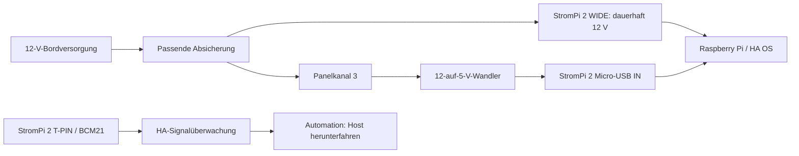

# StromPi 2: vorhandener Aufbau und Abschaltkonzept

Stand: StromPi 2, laut Betreiber Revision 2.1, Raspberry Pi 3 mit HA OS.
Aktuell liegt ausschließlich die über Panelkanal 3 geschaltete 12-V-Versorgung
am Weitbereichseingang an. Micro-USB IN ist nicht angeschlossen.

BCM21 konnte als Eingang rein lesend geprüft werden und meldet High. Das ist
bei fehlender Micro-USB-Versorgung erwartbar, falls der T-PIN-Jumper verbunden
ist. Die tatsächliche Jumperstellung kann Software nicht feststellen.

## Vorschlag ohne zusätzlichen Akku

Das ist ein Planungsvorschlag, keine bereits vorgenommene Umverdrahtung.
Micro-USB ist beim StromPi 2 fest priorisiert. Wird der 5-V-Wandler über Kanal 3
abgeschaltet, übernimmt die dauerhaft anliegende 12-V-Versorgung. Der Pi kann
bei entsprechender Signalverbindung und Automation herunterfahren.

Der Pi bleibt danach elektrisch versorgt. Der StromPi 2 kann die Versorgung
nicht per programmierbarem Timer trennen. Für vollständige Stromtrennung mit
geringem Ruhestrom braucht es einen unabhängigen Lastschalter/Controller oder
eine geeignete USV mit Abschaltfunktion. Soll auch der Ausfall der gesamten
Bordversorgung überbrückt werden, reicht derselbe Bordakku als Reserve nicht;
dafür ist eine unabhängige gepufferte Quelle erforderlich.

## Verbrauch

Der StromPi 2 liefert keine Strommesswerte. Der Gesamtverbrauch nach einem
Software-Shutdown muss an der 12-V-Zuleitung gemessen werden. 3–7 mA aus der
Herstelleranleitung betreffen allein den Wide-Zweig bei aktiver Micro-USB-
Versorgung und sind kein Gesamtwert für einen heruntergefahrenen Pi, der aus
Wide weiter versorgt wird. Das Schaltpanel und zusätzliche Elektronik kommen
bei einer Gesamtmessung gegebenenfalls hinzu.

Quelle: [Joy-IT StromPi-2-Anleitung](https://www.joy-it.net/files/files/Produkte/RB-StromPI2/Anleitung-Strompi2.pdf).
